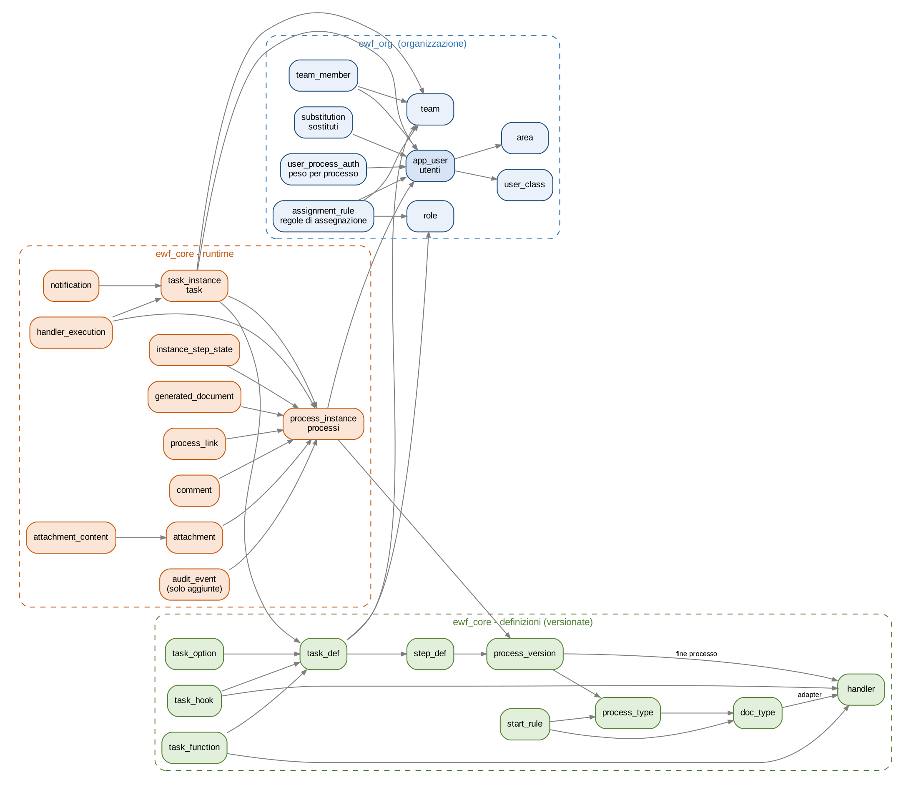

# eWF – Architettura e base dati

**Destinatari:** colleghi del gruppo di sviluppo e-One, esperti di SAP e ABAP, meno di Java, PostgreSQL e CaptainCasa.

**Stato:** bozza 0.3 – novembre 2026 (0.3: designer dei processi, regole di assegnazione e di avvio, protezione delle versioni nel database. 0.2: permessi completi di `ewf_app`, regole su team e sostituzioni, servizi di amministrazione, pagine nuove dell'applicazione, Gantt, allegati SAP, rilascio dal designer e hot deploy). Descrive il prototipo così com'è: schema del database alla versione 0.16, moduli Java, collegamento a SAP S/4HANA Private via RFC.

**Da leggere insieme a:** Analisi funzionale (cosa fa eWF). Qui si spiega come è costruito.

# 1. Come leggere questo documento

Il documento non dà nulla per scontato. Parte da un parallelo con il mondo ABAP, descrive i moduli del sistema, poi la base dati tabella per tabella, e infine segue una richiesta dall'utente fino a SAP e ritorno.

I nomi di tabelle, campi e classi sono scritti `così`. Dove esiste un equivalente nel vecchio eWF ABAP (namespace `/EWF/`) è indicato tra parentesi.

Le parti più tecniche (capitoli 5–8) si possono saltare alla prima lettura: i capitoli 2–4 bastano per orientarsi e per leggere i dati con SQL.

# 2. Dal mondo ABAP a questo

Quasi ogni concetto di eWF ha un parente stretto in ABAP. La tabella è il punto di partenza per tutto il resto.

| In ABAP | Qui | Nota |
| --- | --- | --- |
| Package, componente software | **Progetto Maven** (es. `ewf-engine`) | Una cartella con sorgenti e un file `pom.xml` che dice nome, versione e dipendenze. |
| Classe globale, function group | **Classe Java** | Il codice sta in file `.java`, uno per classe, raggruppati in package (`it.eone.ewf.engine`). |
| Interfaccia ABAP (`IF_…`) | **Interfaccia Java** | Usate molto: il motore dichiara cosa gli serve (es. «leggi un documento») e altri moduli lo realizzano. |
| Dizionario dati (SE11) | **Schema SQL** (`CREATE TABLE`) | Le tabelle si definiscono in un file `.sql`; nessun elemento dati o dominio: tipo e vincoli stanno sulla colonna. |
| Open SQL embedded (`SELECT … INTO`) | **JDBC**: istruzioni SQL scritte in stringhe ed eseguite con `PreparedStatement` | SQL vero di PostgreSQL, non Open SQL. Si vede tutto, niente buffer di tabella. |
| LUW, `COMMIT WORK`, `ROLLBACK WORK` | **Transazione del database**: `commit` / `rollback` sulla connessione | Un blocco di lavoro va tutto o niente. Non c'è un update task: si scrive direttamente, dentro la transazione. |
| `ENQUEUE`/`DEQUEUE` (lock logici) | `SELECT … FOR UPDATE` e **contatore di versione** (`row_version`) | Il lock è del database, non di un server di enqueue; vedi capitolo 5. |
| Transazione SE37, chiamata RFC | **JCo** (SAP Java Connector) | Java chiama le FM RFC come farebbe un programma ABAP remoto. |
| Dynpro, transazione | **Pagina CaptainCasa**: layout XML + classe Java | Il layout descrive i controlli; la classe contiene dati e azioni (come il PBO/PAI). |
| Job (SM36/SM37) | **Scheduler di eone-connect** | Job definiti in tabella, con storico delle esecuzioni. |
| Utenti SU01 | Tabella `ewf_org.app_user` | Utenti propri di eWF; il collegamento all'utente SAP è un campo. |
| Trasporti | **Git** per il codice, **file SQL di migrazione** per il database | Ogni modifica allo schema ha il suo script numerato (es. `ewf_migrate_0.13_to_0.14.sql`). |
| Kernel e application server | **Tomcat** (server applicativo Java) | L'applicazione si installa come file `.war`, un archivio con classi e librerie. |
| Mandante | Nessun equivalente | Un database per ambiente (sviluppo, test, produzione). |

## 2.1 Tre parole che tornano spesso

- **Maven:** lo strumento che compila i progetti Java e scarica le librerie. Le librerie già scaricate stanno nella cartella `.m2` dell'utente. «Maven install» compila un progetto e lo mette in `.m2`, dove gli altri progetti lo trovano.
- **JSON / jsonb:** un formato di testo per strutture chiave/valore, es. `{"WERKS":"D030","BUKRS":"1000"}`. PostgreSQL ha il tipo `jsonb` per salvarlo in una colonna e interrogarlo. Lo usiamo dove i campi variano da caso a caso (attributi del documento, parametri).
- **SPI** (Service Provider Interface): un'interfaccia dichiarata da un modulo e realizzata da un altro. È il modo con cui il motore resta indipendente da SAP: dichiara «mi serve qualcuno che esegua un handler», e il modulo SAP glielo fornisce.

# 3. I moduli

Il sistema è diviso in cinque progetti Maven. Ognuno ha un compito preciso e conosce solo quelli sotto di lui.

| Modulo | Cosa contiene | Dipende da | Produce |
| --- | --- | --- | --- |
| `eone-connect` | Libreria comune e-One: scheduler dei job, storico esecuzioni, stato di sincronizzazione, coda di uscita delle mail. Usata anche da eTile NEXT e fcs. | – | jar |
| `ewf-engine` | Il **motore**: regole di avanzamento, definizioni, processi, task, assegnazioni, audit. Persistenza su PostgreSQL. Nessuna dipendenza da SAP né dall'interfaccia. | – | jar |
| `ewf-service` | Il **livello di servizio** per l'applicazione: login, lista, dettaglio, azioni, commenti, allegati, schede PDF. Dichiara le SPI verso il sistema di origine. | ewf-engine | jar |
| `ewf-sap` | Il **collegamento a SAP** via JCo: esecuzione degli handler, lettura documento, coda degli avvii, schede OdA. Sorgenti ABAP in `abap/`. Programmi di prova (`OdaProbe`). | ewf-engine, ewf-service, eone-connect | jar |
| `ewfserver` | L'**applicazione web** CaptainCasa: pagine, sessione, configurazione, sicurezza HTTP. | ewf-service, ewf-sap | war |

**Ordine di compilazione:** eone-connect → ewf-engine → ewf-service → ewf-sap → ewfserver. Quando si modifica un modulo bisogna fare «Maven install» di quel modulo e poi di quelli che dipendono da lui.

> **Perché questa divisione.** Il motore non sa nulla di SAP: lo stesso motore funzionerà con la Public Edition sostituendo solo `ewf-sap` con un modulo che usa OData. E non sa nulla dell'interfaccia: un domani un'app mobile o un'API userebbero `ewf-service` senza toccare il motore.

# 4. La base dati

## 4.1 Concetti di PostgreSQL usati

| Concetto | Cosa significa qui |
| --- | --- |
| **Database** | `ewf`: contiene tutto eWF (e lo schema di eone-connect). Per i test automatici si usa un database separato, `ewf_test`, che i test svuotano: mai puntare i test su `ewf`. |
| **Schema** | Un «namespace» dentro il database, come `/EWF/` in SAP. Ne usiamo tre: `ewf_org` (organizzazione), `ewf_core` (motore), `eone_connect` (libreria comune). |
| **Ruolo** | Utente del database. `ewf_owner` è il proprietario delle tabelle e fa le modifiche di struttura; `ewf_app` è l'utente con cui si collega l'applicazione, con i soli permessi necessari. |
| **Identity** | `bigint GENERATED ALWAYS AS IDENTITY`: numerazione automatica della chiave, come un range di numeri interno. Processi e task partono da 8000000001, per non confondersi con i numeri del legacy. |
| **timestamptz** | Data e ora con fuso orario. Sostituisce la coppia data + ora di SAP. |
| **NULL** | Valore assente. Nelle regole **NULL significa «qualsiasi valore»**, come il campo vuoto nelle tabelle di customizing SAP. |
| **Vincoli** | `PRIMARY KEY`, `UNIQUE`, `REFERENCES` (chiave esterna: il valore deve esistere nella tabella collegata), `CHECK` (es. lo stato deve essere uno di quelli previsti). Li controlla il database, non il programma. |
| **Indice parziale** | Un indice solo su una parte delle righe, es. solo i task aperti. Usato anche per imporre «un solo processo aperto per documento». |
| **Trigger e funzioni** | Codice eseguito dal database. Ne abbiamo pochi: blocco delle modifiche all'audit, validazione delle versioni, calcolo del peso effettivo. |

## 4.2 Il quadro d'insieme

Le tabelle si dividono in quattro gruppi: **organizzazione** (chi), **definizioni** (come deve andare un processo), **runtime** (come sta andando) e **servizi comuni** (eone-connect). Il diagramma mostra i legami principali; la freccia va dalla tabella che contiene la chiave esterna verso quella a cui punta.



Le definizioni sono **versionate e immutabili** una volta attive: un processo punta alla sua versione (`process_instance.version_id`) e la segue fino alla fine, anche se nel frattempo ne viene attivata un'altra.

## 4.3 Schema ewf_org – organizzazione

### app_user – utenti (ex USER0)

Una riga per persona. È il centro dell'organizzazione: quasi tutte le altre tabelle puntano qui.

| Campo | Significato |
| --- | --- |
| `id` | Chiave interna numerica. Le altre tabelle usano questa, mai il login. |
| `login` | Nome utente per entrare in eWF (ex UNAME). Unico. |
| `display_name`, `email`, `mobile` | Nome visualizzato (ex NAME1 + NAME2) e contatti. |
| `sap_user` | Utente SAP corrispondente (ex UNAME_SAP). Serve a riconoscere chi ha salvato un documento e a passare l'utente agli handler. |
| `weight` | Peso (ex PUNTEGGIO). Vedi `user_process_auth` per il peso per processo. |
| `user_class_code`, `area_code` | Classe utente e area (ex TB_CLS, TB_ARR). |
| `plant`, `purchasing_group` | Divisione e gruppo acquisti di riferimento dell'utente. |
| `mail_every_days`, `last_mail_on` | Ogni quanti giorni ricevere il riepilogo e quando è stato mandato l'ultimo. |
| `can_suspend`, `can_delete`, `can_substitute` | Permessi che sovrascrivono quelli della classe; NULL = vale la classe. |
| `active`, `hidden_in_lists` | Utente attivo; nascosto negli elenchi di scelta. |
| `password_hash` | Impronta della password (mai la password). Vedi capitolo 9. |
| `password_must_change`, `failed_logins`, `locked_until`, `last_login_at` | Stato dell'accesso: cambio obbligatorio, tentativi falliti, blocco temporaneo, ultimo accesso. |
| `idp_issuer`, `idp_subject` | Predisposti per l'accesso tramite un identity provider esterno (OIDC); oggi non usati. |

### Le altre tabelle dell'organizzazione

| Tabella | Legacy | Contenuto |
| --- | --- | --- |
| `user_class` | TB_CLS | Classi utente con i loro permessi e livelli. |
| `area` | TB_ARR | Aree organizzative. |
| `team` | TB_TEAM | Team (codice e descrizione). |
| `team_member` | USER0.TEAM | Chi sta in quale team, con validità facoltativa. Chiave (team, utente): un utente può stare in più team, ma **una sola riga per team**; se esce e rientra, il periodo nuovo sovrascrive il vecchio. |
| `role` | ROLES | Ruoli usati dai task (es. RESPONSABILE_ACQ). |
| `assignment_rule` | USER_TASK | **Regole di assegnazione:** ruolo + criteri facoltativi (tipo processo, gruppo acquisti, divisione, magazzino, fascia d'importo con divisa, validità) → utente oppure team. Almeno uno dei due destinatari deve esserci (vincolo CHECK). |
| `assignment_exception` | WF_CLI_USER | Eccezioni: per un ruolo e un utente richiedente, chi autorizza al suo posto. **Migrata ma non usata dal motore**, come le tre tabelle seguenti: funzioni da realizzare per cliente (Registro, D16). |
| `role_group_member` | CDO_USERGRP | Gruppi di utenti intercambiabili per ruolo. |
| `role_team_auth` | CDO_AUTH | Quali team sono autorizzati per un ruolo. |
| `user_process_auth` | USR_AUTH | Peso dell'utente per uno specifico tipo processo; se presente e attivo, prevale su `app_user.weight`. |
| `substitution` | SOSTITUTI | Sostituzioni: utente, sostituto, dal, al, chi l'ha decisa e quando (`changed_by`, `changed_at`). Il database impedisce date invertite e l'autosostituzione; il servizio impedisce le sovrapposizioni e gli inizi nel passato. |

### Regole applicate dal servizio

- **Fine di un'appartenenza o di una sostituzione:** se è già iniziata si chiude a ieri (`valid_to`), così resta nello storico; se doveva ancora iniziare si cancella.
- **Almeno un amministratore:** gli amministratori sono i membri attivi del team di riserva (`WFADM`, da `EngineConfig.fallbackTeamCode`). Ogni modifica di team o utenti verifica, **dentro la stessa transazione**, che ne resti almeno uno attivo; altrimenti tutto torna indietro.
- **Nuovi utenti e sequenza:** `app_user.id` è una colonna identity. La migrazione inserisce utenti con id esplicito, quindi dopo ogni inserimento così `JdbcOrgWriter` riallinea la sequenza (`setval(pg_get_serial_sequence(...), max(id))`); senza, il primo utente creato dall'applicazione andrebbe in conflitto di chiave. Sugli ambienti già migrati il riallineamento va fatto una volta a mano.

## 4.4 Schema ewf_core – configurazione tecnica

| Tabella | Contenuto |
| --- | --- |
| `backend_system` | I sistemi di origine (un cliente può averne più d'uno): codice, tipo (`ECC`, `S4_PRIVATE`, `S4_ONPREM`, `S4_PUBLIC`, `OTHER`) e un riferimento alla configurazione di collegamento. **Nessuna password**: il riferimento punta a configurazione esterna. |
| `parameter` | Parametri generali chiave/valore (ex PARAMETRI). |
| `handler` | **Catalogo degli handler**: codice (es. `/EWF/WF_RIL_ODA`), tipo (`RFC_FM`, `API`, `JAVA`, `INTERACTIVE`), contratto (`TASK_ACTION`, `ASSIGNEE`, `PROCESS_END`, `DOC_ADAPTER`), destinazione, se è idempotente, configurazione. |
| `doc_type` | Tipi documento (ex Z_WF_TIPODOC): codice, descrizione, handler adattatore (es. `/EWF/DOC_INFO`), formato della chiave. |

## 4.5 Schema ewf_core – definizioni

### process_type – tipo processo (ex PROCESSO + PROCTYPE)

| Campo | Significato |
| --- | --- |
| `code`, `description`, `doc_type` | Codice (es. EONE_ODA), descrizione, tipo documento. |
| `manual_start`, `lock_changes`, `suspended`, `fictitious`… | Indicatori ereditati dal legacy. |
| `change_tolerance_pct` | Tolleranza percentuale sulle modifiche di quantità/valore per posizione: oltre, il processo si riavvia. |
| `list_summary` | Modello del riepilogo nella lista delle attività, con segnaposto `{chiave}`. |
| `list_columns` | Colonne specifiche (jsonb): elenco di etichetta + chiave. |
| `sla_yellow_days`, `sla_red_days` | Soglie del semaforo dei giorni di attesa (default 6 e 11). |
| `attachment_scope` | `PROCESS` = allegati nel DB eWF; `DOCUMENT` = nel sistema di origine; `BOTH` = entrambi, nuovi file in eWF (dalla 0.15). |
| `legacy_flags` | Indicatori del legacy senza un campo dedicato (jsonb). |

### process_version, step_def, task_def – la definizione (ex TASK)

| Tabella | Contenuto |
| --- | --- |
| `process_version` | Versione di un tipo processo: numero, stato (`DRAFT`, `ACTIVE`, `RETIRED`), handler e parametri dell'azione di fine processo (ex Z_WF_FM_END_PROC, es. `{"Z_WF_SET_RIL":"01"}`). Un indice garantisce **una sola versione attiva** per tipo. |
| `step_def` | Step di una versione: numero, primo sì/no, regola di ricongiungimento (`ALL`/`ANY`), step successivo OK e KO (NULL = fine), soglia d'importo minima con divisa, codice opzione per le varianti di ramo. Unico per (versione, numero, opzione). |
| `task_def` | Task di uno step (ex Z_WF_SUBOP): testo, ruolo, peso richiesto, modalità di assegnazione (`RULES`, `HANDLER`, `STARTER`, `ACTOR`, `PREVIOUS`), handler di assegnazione, task di team e team fisso, modalità di anteprima nel percorso (`NAME`, `ROLE`, `HIDDEN`), interazione (`WEB`, `INTERACTIVE`, `SAPGUI_ONLY`), avviso mail (`notify`: `NONE`/`IMMEDIATE`). |
| `task_hook` | Agganci evento → handler: `BEFORE_ACTION`, `ON_OK`, `ON_KO`, `ON_ACTIVATE`, `BUTTON`, con sequenza e parametri (jsonb). |
| `task_option` | Opzioni dei nodi di scelta: codice, etichetta, se vale come rifiuto, handler, processo da avviare e modalità (`HANDOFF`/`PARALLEL`). |
| `task_function` | Funzioni speciali del dettaglio: codice, etichetta, handler, testo di conferma, posizione. |
| `start_rule` | Regole di avvio automatico: tipo documento, condizioni sugli attributi (jsonb, `*` = qualsiasi), priorità, tipo processo. |
| `mail_template` | Modelli delle mail (`TASK_ACTIVATED`, `DIGEST`) per lingua, con segnaposto `{{nome}}`. |

## 4.6 Schema ewf_core – runtime

### process_instance – i processi (ex PROCDOC + PROCRUN)

| Campo | Significato |
| --- | --- |
| `id` | Numero del processo (da 8000000001). |
| `version_id`, `process_type_code` | Versione e tipo con cui è partito. |
| `backend_code`, `doc_type`, `document_key` | Sistema, tipo e chiave del documento (es. F / 4500001064). |
| `status`, `status_reason` | Stato (vedi Analisi funzionale 4.1) e motivo, es. `END_FAILED: …`, `RESTARTED`. |
| `net_value`, `currency` | Valore del documento all'avvio. |
| `doc_context` | **Fotografia del documento** (jsonb): attributi e descrizioni, es. `sap.LIFNR`, `sap.LIFNR_TXT`. Usata da regole, lista e schede. |
| `doc_items` | Posizioni all'avvio (jsonb): posizione → «quantità\|valore». Serve a valutare le modifiche. |
| `started_at/by`, `ended_at/by` | Avvio e chiusura. |
| `correlation_key` | Identificativo univoco del processo da scrivere nei documenti SAP. |
| `legacy_procid` | Numero del processo nel legacy, se migrato. |
| `row_version` | Contatore di versione per i controlli di concorrenza. |

Un indice unico parziale impone **un solo processo aperto** per (tipo processo, tipo documento, chiave, sistema): è il controllo che `WF_START` faceva con una SELECT, ma qui lo garantisce il database anche con due avvii simultanei.

### task_instance – i task (ex TASKRUN)

| Campo | Significato |
| --- | --- |
| `id`, `process_id`, `task_def_id`, `step_no`, `subop_no` | Identità del task e collocazione nella definizione. |
| `status` | `OPEN`, `EXECUTING`, `OK`, `KO`, `MOVED`, `CANCELLED`, `SKIPPED`, `ERROR`. |
| `assignee_id`, `team_code`, `role_code` | Titolare, oppure team per i task di team; ruolo da cui è stato determinato. |
| `claimed_by_id`, `claimed_at` | Presa in carico (task di team). |
| `from_user_id`, `moved_to_id` | Spostamenti (ex Z_WF_FROM_USER, Z_WF_MOVE_TO). |
| `acted_by_id`, `acted_as_subst` | Chi ha agito davvero e se come sostituto (ex Z_WF_SOSTITUTO). |
| `action`, `option_code`, `note` | Azione registrata (ex Z_WF_AZIONE), opzione scelta, nota. |
| `created_at`, `closed_at` | Apertura e chiusura: da qui i giorni di attesa. |
| `row_version` | Contatore per il doppio clic e le azioni simultanee. |

### Le altre tabelle del runtime

| Tabella | Contenuto |
| --- | --- |
| `instance_step_state` | Step saltati in un processo e perché (`AMOUNT_BELOW_MIN`, `HANDLER`, `MANUAL`). Scritta solo dal motore. |
| `handler_execution` | **Ogni chiamata a un handler**: evento, tentativo, chiave di idempotenza, stato (`PENDING`, `RUNNING`, `OK`, `KO`, `UNKNOWN`), messaggio, istruzioni ricevute, richiesta e risposta (jsonb), inizio e fine. È il primo posto dove guardare quando qualcosa non va con SAP. |
| `generated_document` | Documenti creati in SAP dagli handler (ex TASKDOCUM). |
| `process_link` | Collegamenti tra processi (passaggio di consegne, parallelo). |
| `comment` | Commenti sul processo (tipo `N` = nota dell'utente). |
| `attachment` | Metadati degli allegati: nome, tipo, dimensione, chi e quando, provider (`LOCAL`, `SAP_GOS`…), cancellazione logica (`deleted_at/by`). |
| `attachment_content` | Il contenuto binario degli allegati locali, separato dai metadati: le liste non leggono mai i file. |
| `notification` | Avvisi da trasformare in mail, scritti dal motore nella stessa transazione del task. |
| `audit_event` | Registro di tutto ciò che accade: chi (utente, sistema, handler), cosa, quando, su quale processo e task, dettagli (jsonb). **Solo aggiunte**: un trigger blocca UPDATE e DELETE. |

## 4.7 Funzioni nel database

| Funzione | Cosa fa |
| --- | --- |
| `ewf_core.validate_version(id)` | Controlla una versione prima dell'attivazione: un solo primo step, nessuna transizione verso step inesistenti, nessuno step senza task, handler presente dove serve; avvisa per step non raggiungibili. |
| `ewf_org.effective_weight(utente, processo)` | Peso effettivo: quello per processo se attivo, altrimenti quello dell'utente. |
| `ewf_core.audit_no_change()` | Usata dal trigger che rende l'audit non modificabile. |
| `guard_definition_row()`, `guard_process_version()` | Trigger della 0.16 su versioni, step, task, agganci, opzioni e funzioni: per l'utente `ewf_app` una definizione si modifica **solo se la versione è in bozza**; una versione attiva può solo essere ritirata. Gli script di `ewf_owner` non sono toccati. |

## 4.8 Schema eone_connect – servizi comuni

| Tabella | Contenuto |
| --- | --- |
| `job` | Job pianificati: codice, implementazione, pianificazione (es. `every 30s`, `daily 07:15 mon-fri`), fuso, attivo, parametri, prossima esecuzione. |
| `job_run` | Storico delle esecuzioni: nodo, inizio, fine, esito (`OK`, `WARNING`, `ERROR`, `ABORTED`), messaggio, conteggi. |
| `sync_state` | Punto da cui riprendere le letture incrementali da sistemi esterni (non usato da eWF). |
| `mail_outbox` | Coda di uscita delle mail: destinatari, testo, stato (`NEW`, `SENDING`, `SENT`, `ERROR`, `DEAD`), tentativi; una chiave impedisce i doppioni. |
| `schema_version` | Versione dello schema installata. |

## 4.9 Ruoli e permessi

- `ewf_owner` è il proprietario di tutte le tabelle. Con lui si creano lo schema e si applicano le migrazioni. Se una tabella viene creata con un altro utente (per esempio l'amministratore `postgres`), va riassegnata a `ewf_owner`.
- `ewf_app` è l'utente dell'applicazione. Ha solo i permessi che servono, anche **a livello di colonna**. Sull'audit può solo aggiungere.
- Le password dei due ruoli non stanno in nessun file: si passano all'applicazione con variabili d'ambiente (`EWF_DB_PASSWORD`).

I permessi di `ewf_app` stanno ora in un unico script, `db/ewf_grants_app.sql` di `ewf-engine`, completo e rieseguibile: si lancia come `ewf_owner` dopo ogni migrazione e in ogni ambiente nuovo. Le scritture concesse sull'organizzazione sono quelle che servono alle funzioni di amministrazione:

| Tabella | Permessi di scrittura di `ewf_app` |
| --- | --- |
| `app_user` | INSERT; UPDATE solo su campi dell'accesso, `display_name`, `email`, `sap_user`, `user_class_code`, `can_substitute`, `active`, data del riepilogo. Peso e livelli restano fuori. |
| `team` | INSERT; UPDATE della sola descrizione. |
| `team_member` | INSERT, DELETE; UPDATE di `valid_from`, `valid_to`. |
| `substitution` | INSERT, DELETE; UPDATE di `valid_to`, `changed_by`, `changed_at`. |
| `role` | INSERT, DELETE; UPDATE della sola descrizione. |
| `assignment_rule` | INSERT, UPDATE, DELETE. |
| definizioni dei processi | `process_version`: INSERT, DELETE, UPDATE di stato, data di attivazione, nota e azione finale. `step_def`, `task_def`, `task_hook`, `task_option`, `task_function`: INSERT, UPDATE, DELETE, sempre sotto i trigger delle bozze. |
| `start_rule` | INSERT, UPDATE, DELETE. |
| tabelle runtime del motore | Quelle di processi, task, storico, commenti, allegati, coda; audit solo INSERT. |

## 4.10 Versioni dello schema

Nella cartella `db/` di `ewf-engine` ci sono:

- `ewf_schema_v0.16.sql`: schema completo, per un database nuovo;
- `ewf_migrate_X_to_Y.sql`: le migrazioni da una versione alla successiva (dalla 0.4 alla 0.16), da applicare in ordine come `ewf_owner`;
- `ewf_grants_app.sql`: i permessi di `ewf_app`, da rieseguire dopo ogni migrazione.

È lo stesso principio dei trasporti: ogni cambiamento di struttura ha il suo script, e un ambiente si porta avanti applicando gli script mancanti. Schema completo e migrazioni producono lo stesso risultato (verificato confrontando gli schemi con `pg_dump`).

## 4.11 Leggere i dati: esempi di SQL

Query utili per orientarsi, eseguibili da pgAdmin. Sostituire i valori di esempio.

**Task aperti di un utente:**

```sql
SELECT t.id, p.process_type_code, p.document_key, d.text, t.created_at
  FROM ewf_core.task_instance t
  JOIN ewf_core.process_instance p ON p.id = t.process_id
  JOIN ewf_core.task_def d         ON d.id = t.task_def_id
  JOIN ewf_org.app_user u          ON u.id = t.assignee_id
 WHERE t.status = 'OPEN' AND u.login = 'EONE';
```

**Storico di un processo:**

```sql
SELECT t.step_no, d.text, t.status, a.display_name AS chi, t.closed_at, t.note
  FROM ewf_core.task_instance t
  JOIN ewf_core.task_def d    ON d.id = t.task_def_id
  LEFT JOIN ewf_org.app_user a ON a.id = t.acted_by_id
 WHERE t.process_id = 8000000014
 ORDER BY t.created_at;
```

**Fotografia del documento, una riga per attributo:**

```sql
SELECT key, value
  FROM ewf_core.process_instance p, jsonb_each_text(p.doc_context)
 WHERE p.id = 8000000014
 ORDER BY key;
```

**Ultime chiamate a SAP non andate a buon fine:**

```sql
SELECT process_id, task_id, handler_code, event, status, result_message, started_at
  FROM ewf_core.handler_execution
 WHERE status IN ('KO', 'UNKNOWN')
 ORDER BY started_at DESC
 LIMIT 20;
```

# 5. Il motore

## 5.1 Come è organizzato

| Package | Contenuto |
| --- | --- |
| `engine` | `WorkflowEngine`: tutte le operazioni (avvia, agisci, scegli, sposta, riavvia, annulla, lista, percorso…). `Requests`: richieste e risposte. `EngineException`: errori con codici stabili. |
| `engine.model` | Le definizioni (tipo processo, versione, step, task, agganci) e gli oggetti di runtime (processo, task, esecuzione handler). |
| `engine.spi` | Le interfacce che il motore chiede ad altri: archivio dati, utenti, risoluzione degli assegnatari, esecuzione handler, lettura documento, audit, transazioni. |
| `engine.assign` | Il risolutore delle regole di assegnazione (generalizza `/EWF/WF_USER_TASK`). `explain` restituisce tutte le regole del ruolo con l'esito e il motivo di esclusione; l'assegnazione normale passa da lì, così il simulatore mostra esattamente la scelta del motore. |
| `engine.jdbc` | La realizzazione su PostgreSQL di tutte le interfacce, con solo JDBC (nessuna libreria esterna). |
| `engine.memory` | Una realizzazione in memoria, usata nei test: gli stessi scenari girano sia in memoria sia su PostgreSQL. |

## 5.2 Transazioni e lock: come si evita il caos

È la parte più delicata, e la differenza principale rispetto al legacy. Un'azione su un task (per esempio «Approva») avviene in **tre tempi**:

1. **Prima transazione, breve:** si rilegge il task, si controlla che sia aperto, che il contatore di versione sia quello atteso (nessuno l'ha cambiato nel frattempo) e che l'utente sia autorizzato. Il task passa a `EXECUTING`. Commit.
1. **Fuori da ogni transazione:** si chiamano gli handler in SAP (controllo blocco, azioni su OK/KO). Ogni chiamata è registrata in `handler_execution` con una chiave di idempotenza.
1. **Seconda transazione:** si **blocca la riga del processo** (`SELECT … FOR UPDATE`), si chiude il task, si valuta lo step (ALL/ANY), si creano i task dello step successivo, le notifiche e le righe di audit. Commit: tutto o niente.

Perché così:

- Una chiamata RFC può durare secondi; tenere aperta una transazione del database per tutto quel tempo bloccherebbe altri utenti. Lo stato `EXECUTING` fa da «lock logico» durante la chiamata.
- Se un handler fallisce (KO), il task torna `OPEN` e il processo non si muove. Se l'esito è incerto (UNKNOWN), il task resta `EXECUTING` e il processo va in `ERROR`: nessuno può agire finché un amministratore non verifica.
- Il blocco della riga del processo mette in fila due approvazioni parallele arrivate nello stesso istante: il processo avanza una sola volta.
- Il contatore di versione (`row_version`) intercetta il doppio clic e due utenti sullo stesso task: il secondo riceve «modificato da un altro utente».

## 5.3 Fine processo

Quando l'ultimo step è approvato, il processo passa in `COMPLETING` e il motore chiama l'azione di fine processo (per l'OdA il rilascio). Il processo diventa `COMPLETED` **solo se** l'azione riesce; altrimenti va in `ERROR` con il motivo, e si può ritentare. In questo modo eWF non dichiara mai «approvato» un OdA che in SAP non è rilasciato.

# 6. Il giro di una richiesta: «Approva»

Seguiamo il clic su «Approva» dal browser fino a SAP e ritorno.

| # | Dove | Cosa succede |
| --- | --- | --- |
| 1 | Browser | L'utente preme «Approva». Il browser manda la richiesta a Tomcat (`/ewfserver/…risc`). |
| 2 | CaptainCasa | Il framework individua la pagina e chiama il metodo `onApprove` della classe `TaskDetailUI`. |
| 3 | `TaskDetailUI` | Chiede conferma (finestra Sì/No). Alla conferma chiama `EwfService.approve(utente, task, nota, versione)`. |
| 4 | `EwfService` | Verifica che l'utente possa vedere il processo e passa la richiesta al motore. |
| 5 | `WorkflowEngine` | Prima transazione: controlli, task in `EXECUTING`. |
| 6 | `ewf-sap` | Aggancio `BEFORE_ACTION`: `JcoDispatcherHandler` chiama in RFC `/EWF/ENGINE_DISPATCH`, che chiama `/EWF/WF_CHECK_LOCK_EKKO`. Se l'OdA è aperto in ME22N risponde KO: il task torna aperto e l'utente vede il motivo. |
| 7 | `WorkflowEngine` | Agganci `ON_OK`, se previsti. Poi seconda transazione: blocco del processo, chiusura del task, creazione dei task dello step successivo, notifica, audit. |
| 8 | `WorkflowEngine` | Se era l'ultimo step: `COMPLETING`, chiamata a `/EWF/WF_RIL_ODA` (rilascio), poi `COMPLETED`. |
| 9 | Ritorno | Il motore restituisce l'esito (fatto, rifiutato, incerto). La pagina mostra il messaggio e torna alla lista. |

In parallelo, ogni minuto, il job delle notifiche trasforma le righe di `notification` in mail (`mail_outbox`), e il job di spedizione le invia.

# 7. Il collegamento a SAP

## 7.1 JCo e destinazioni

Java parla con SAP tramite **JCo**, la libreria SAP per le chiamate RFC. Richiede due file: `sapjco3.jar` (la parte Java) e `sapjco3.dll` (la parte nativa, su Windows). In Tomcat il jar va in `tomcat\lib` e la dll in una cartella del `PATH`.

La **destinazione** (come una destinazione RFC di SM59) è un file `<NOME>.properties` in una cartella esterna al progetto, indicata dalla variabile `EWF_SAP_CONFIG_DIR`: server, numero di sistema, mandante, utente, lingua. La password **non** sta nel file ma nella variabile `EWF_SAP_<NOME>_PASSWD`; se il file contiene una password, il collegamento si rifiuta di partire.

## 7.2 Il dispatcher degli handler

Il motore non chiama direttamente le FM legacy: chiama sempre la FM RFC `/EWF/ENGINE_DISPATCH`, passando il nome della FM da eseguire e i dati del processo e del task (gli stessi campi di `/EWF/TASKRUN`). Il dispatcher:

- chiama la FM legacy con l'interfaccia che si aspetta, così le FM esistenti si riusano senza modifiche;
- registra l'esecuzione con la **chiave di idempotenza**: se il motore ripete la chiamata (per esempio dopo un errore di rete), la FM non viene rieseguita e si restituisce l'esito già registrato;
- restituisce esito (`O`/`K`/`U` → OK/KO/UNKNOWN), messaggio, documenti creati e istruzioni al motore.

I parametri di un aggancio (`task_hook.config`) che hanno il nome di un campo di `/EWF/TASKRUN` (es. `Z_WF_SET_RIL`) valorizzano quel campo; gli altri vanno ai parametri omonimi della FM.

## 7.3 La coda degli avvii

| Oggetto SAP | Ruolo |
| --- | --- |
| BAdI `ME_PROCESS_PO_CUST~POST` | Punto di aggancio al salvataggio dell'OdA. |
| `/EWF/CTX_PO` | Estrattore: attributi (società, org. acquisti, gruppo acquisti, tipo, fornitore, divisione) con le descrizioni, e posizioni attive. Non legge dal DB perché gira dentro il salvataggio: usa i dati in memoria. |
| `/EWF/START_Q_WRITE` | Modulo di aggiornamento: scrive l'evento nella LUW del documento. |
| `/EWF/START_Q`, `_QA`, `_QI` | Tabelle della coda: testata dell'evento, attributi, posizioni. |
| `/EWF/START_Q_READ`, `/EWF/START_Q_CONFIRM` | RFC usate da eWF per leggere gli eventi e confermare l'esito. |
| `/EWF/START_CFG` | Per tipo documento: elabora il motore Java (`J`), il ponte legacy (`L`) o nessuno (`N`). |
| `/EWF/DOC_INFO` | Lettura del documento su richiesta (riavvio, avvio manuale), con lo stesso estrattore. |

Lato eWF, il job `EWF_START_QUEUE` di eone-connect legge la coda ogni 30 secondi. Con più Tomcat accesi gira su uno solo, grazie a un lock del database.

Il pulsante **Aggiorna** della lista chiama `JobHost.readStartQueueNow(timeout)`: anticipa la prossima esecuzione del job e aspetta al massimo qualche secondo. Le esecuzioni che non trovano nulla non vengono scritte in `job_run`, quindi la fine si riconosce confrontando due fotografie: o cambia l'istante dell'ultima esecuzione a vuoto, o compare una nuova riga in `job_run`. L'esito (`DONE`, `FAILED`, `STILL_RUNNING`, `NOT_ACTIVE`) decide il messaggio all'utente; la lista si rilegge comunque.

## 7.4 Allegati del documento

L'adattatore `SapDocumentAttachments` (`ewf-sap`, pacchetto `attach`) realizza la SPI `DocumentAttachments` con tre FM abilitate RFC del gruppo di `/EWF/DOC_INFO`. Il tipo documento eWF si traduce nel tipo oggetto SAP (`F` → `BUS2012`), la chiave è il numero con gli zeri iniziali.

| Oggetto SAP | Ruolo |
| --- | --- |
| `/EWF/DOC_ATTACH_LIST` | Elenco degli allegati di un oggetto: GOS (relazioni `ATTA` in `SRGBTBREL`, intestazione in `SOOD`) e ArchiveLink (`ARCHIV_GET_CONNECTIONS`, nome da `TOAAT` o `TOASP`, tipo da `TOADD`). Struttura `/EWF/ST_DOC_ATTACH`. |
| `/EWF/DOC_ATTACH_GET` | Contenuto di un allegato (`SO_DOCUMENT_READ_API1` per GOS, `ARCHIVOBJECT_GET_TABLE` per ArchiveLink). Prima rilegge l'elenco e rifiuta un id non collegato a quell'oggetto: conoscere l'id non basta. |
| `/EWF/DOC_ATTACH_COUNT` | Numero di allegati per più oggetti in una sola chiamata, per i pulsanti della lista. Struttura `/EWF/ST_DOC_ATTACH_CNT`. |

- L'id di un allegato è opaco per eWF: `G` + `INSTID_B` per GOS, `A` + archivio + id documento + classe per ArchiveLink.
- Il caricamento in SAP non è ancora previsto (`canAdd` = falso): con `BOTH` i nuovi file vanno in eWF.
- Se SAP non risponde, la lista non fallisce: il pulsante resta attivo senza numero e l'elenco mostra gli allegati eWF con un avviso.
- **Nota JCo:** i campi data e ora (DATS, TIMS) letti come testo arrivano nel formato `2026-11-19` e `14:30:00`, non come in ABAP (`20261119`, `143000`). L'adattatore accetta entrambi.
- L'utente RFC deve avere il permesso di leggere i documenti SAPoffice.

## 7.5 Schede documento

La scheda OdA legge l'ordine al momento con `BAPI_PO_GETDETAIL1`, i valori per posizione con `/EWF/DOC_INFO`, l'indirizzo del fornitore e il nome della società con `BAPI_VENDOR_GETDETAIL` e `BAPI_COMPANYCODE_GETDETAIL`. Le descrizioni vengono dalla fotografia del processo. Il PDF lo impagina un unico componente comune a tutte le schede (`SheetPdf`, libreria OpenPDF nella stessa versione usata da CaptainCasa).

# 8. Livello di servizio e applicazione web

## 8.1 ewf-service

- `EwfService`: l'unica porta d'ingresso per l'interfaccia. Ogni metodo riceve l'utente, controlla cosa può vedere o fare, e restituisce oggetti pronti per la pagina (`Views`): lista, dettaglio, percorso, storico, allegati…
- `AuthService`: login, cambio e reimpostazione password, blocco dopo i tentativi falliti.
- `SubstitutionService`: sostituzioni dell'utente (auto-sostituzione: un solo sostituto, `setMine`/`clearMine`) e, per l'amministratore, di tutti.
- `AdminService`: tutto ciò che è riservato agli amministratori, ognuno con `requireAdmin` in testa: processi in errore (riprova, conferma dell'esito), elenco e annullamento dei processi, avvio forzato (tipi documento → processi ammessi → avvio), sostituzioni di tutti, utenti, team e appartenenze.
- In `EwfService`, oltre a lista e dettaglio: `timeline` (dati del Gantt), `infoCounts` (numeri di allegati, commenti e storico per i pulsanti in riga, con una query per tutta la lista), `participated` (processi a cui ho partecipato, con il ruolo avuto). La visibilità di un processo include ora gli amministratori e chi vi ha scritto un commento o caricato un allegato.
- SPI verso il sistema di origine: `DocumentSheets` (schede PDF), `DocumentAttachments` (allegati del documento: elenco, contenuto, conteggio per più documenti, se accetta nuovi file), `SapGuiLink` (apertura in SAP GUI). Il modulo SAP realizza schede e allegati via RFC; il collegamento SAP GUI non è ancora collegato. Per la Public Edition se ne scriveranno realizzazioni OData.
- `DesignerService`: tipi processo e versioni; vista di una versione (definizione caricata dal motore e validazione); nuova versione come copia **nel database, colonna per colonna** (così si copiano anche i dati che il modello del motore non conosce, come le funzioni speciali); modifica di step, task, agganci, opzioni, funzioni e azione finale; attivazione con `JdbcDefinitionWriter.activate`. Ogni modifica verifica che la versione sia in bozza.
- `AssignmentService`: ruoli, regole di assegnazione, avvisi (sovrapposizioni con la stessa specificità, destinatari disattivati, regole scadute, ruoli senza regole) e simulatore basato su `RuleBasedAssignmentResolver.explain`.
- `StartRuleService`: regole di avvio, avvisi e simulatore basato su `StartRule.choose` (lo stesso usato da `WorkflowEngine` quando arriva un documento); lettura degli attributi di un documento vero con `WorkflowEngine.documentContext`.
- Errori con codici stabili (`ServiceException`): non trovato, non autorizzato, dati non validi, stato non valido, sistema di origine non disponibile…

## 8.2 ewfserver

| Elemento | Ruolo |
| --- | --- |
| `Outest` | Unica pagina che si può aprire da URL: contiene le altre e gestisce la navigazione (logon → menu → funzione). Accetta il collegamento diretto a un task (`Outest.risc?task=<id>`), che apre subito il dettaglio. |
| `Logon`, `Menu` | Accesso in stile ticketing (immagine casuale da `/images/1..10.jpg`) e menu a schede con la sintesi delle attività. |
| `Worklist`, `TaskDetail`, `ProcessInfo` | Lista con filtri per colonna (`t:gridheader`) e pulsanti in riga; dettaglio (anche in sola consultazione); finestra Allegati / Commenti / Storico / Gantt. |
| `ProcessList` | Processi a cui ho partecipato e, in modalità amministratore, gestione processi con Annulla (`CancelProcess`). |
| `AutoSubstitution`, `Substitutions` | Auto-sostituzione e consultazione. |
| `Errors`, `ForceStart`, `AdminSubstitutions`, `Users`, `Teams` | Funzioni da amministratore. |
| `Designer`, `StepEdit`, `TaskEdit`, `VersionEdit` | Disegno processi: tipi, versioni, diagramma e validazione; finestre di modifica dello step, del task (con agganci, opzioni, funzioni) e delle proprietà della versione. |
| `FlowSvg` | Diagramma del flusso come SVG lato server, con la stessa tecnica del Gantt: una riga per step, una colonna per il tronco e per ogni ramo; frecce verdi (approvazione / opzione) e rosse tratteggiate (rifiuto), suggerimenti con `<title>`. |
| `Assignments`, `RuleEdit`, `StartRules`, `StartRuleEdit` | Assegnazioni e avvio: ruoli, regole di assegnazione con simulatore; regole di avvio (pagina inclusa con `t:rowpagebeaninclude`) con simulatore. |
| `GanttSvg` | Disegna il Gantt come SVG lato server, mostrato con `t:svgviewer`. Una riga per persona; scala compressa: lo spazio tra due istanti consecutivi è proporzionale a 1 + ln(1 + minuti), con le attese lunghe segnate `//`. Il suggerimento al passaggio del mouse è il `<title>` SVG di ogni barra. Nessuna libreria esterna. |
| `EwfApp` | Avvia una volta sola, alla prima richiesta, i servizi condivisi da tutte le sessioni: collegamento al DB, motore, servizi, collegamento a SAP. |
| `JobHost` | Ospita lo scheduler di eone-connect dentro Tomcat; espone la lettura immediata della coda. |
| `AppConfig` | Legge la configurazione da un file esterno (`config.properties`) o dalle variabili d'ambiente. Le password le legge **solo** dall'ambiente e ignora quelle scritte nel file. |
| `EwfSession`, `SessionGuard` | L'utente collegato, tenuto nella sessione; ogni pagina verifica che ci sia. |
| `SecurityHeadersFilter` | Aggiunge a ogni risposta le intestazioni di sicurezza HTTP (vedi capitolo 9). |

### Convenzioni delle pagine

- Ogni pagina ha un layout XML in `src/main/resources` e una classe in `it.eone.ewf.ewfserver.view`; ogni pagina ha il pulsante « Menu (`IBackToMenu`).
- **Nomi delle proprietà:** le espressioni delle pagine seguono le regole JavaBeans. Un getter `getFDocument` produce la proprietà `FDocument`, non `fDocument`: per questo i filtri si chiamano `getFilterDocument` e simili. Le espressioni vengono verificate con un controllo automatico (Introspector) prima della consegna.
- Nelle espressioni si evita la negazione `!`: si usano getter espliciti (`isNotX`).

### Rilascio dal designer CaptainCasa e hot deploy

CaptainCasa usa due classloader. Quello dell'**applicazione** legge `WEB-INF/classes` e `WEB-INF/lib`; quello dell'**hot deploy** legge `eclnthotdeploy/classes`, è figlio del primo e si può rimpiazzare senza riavviare l'applicazione. Il figlio vede le classi del padre, il padre non vede quelle del figlio.

Tomcat carica da solo, con il classloader dell'applicazione, le classi dichiarate nel `web.xml`: in `ewfserver` il listener `JobHost` (avvia lo scheduler) e il filtro `SecurityHeadersFilter`. Queste classi, e quello che usano (`app`, `config`, `context`, `web`), devono quindi stare in `WEB-INF/classes`.

Per questo nel `.ccproject` l'hot deploy è limitato alle pagine:

`<hotdeploymentpackage name="it.eone.ewf.ewfserver.view"/>`

- **Hot deploy** per le classi `view` e per le pagine XML: il designer le copia in `eclnthotdeploy/classes`, senza riavviare.
- **Maven install + Reload** per tutto il resto: moduli `ewf-*` e classi fuori da `view`. Il Reload copia `target/ewfserver` nel runtime e mette in `WEB-INF/classes` tutto ciò che non è hot deploy.
- Start/Stop del designer avvia e ferma l'applicazione e basta: non copia nulla.
- Le classi `app`, `config`, `context` e `web` non devono mai usare classi di `view`.

> **Attenzione al valore proposto dal designer.** Con `name="*"` tutte le classi vanno in hot deploy, `WEB-INF/classes` resta vuota e Tomcat non trova il listener (`ClassNotFoundException: …JobHost`). Durante lo sviluppo il problema è rimasto nascosto da copie manuali residue in `WEB-INF/classes`. **Non copiare mai a mano classi o XML nel runtime:** si nascondono gli errori di configurazione.

# 9. Sicurezza

- **Password degli utenti:** il database conserva solo un'impronta calcolata con PBKDF2-HMAC-SHA256, 600.000 iterazioni e un valore casuale diverso per ogni utente. Dall'impronta non si risale alla password.
- **Tentativi di accesso:** dopo 5 errori, blocco di 15 minuti; messaggio generico.
- **Segreti fuori dai file:** password del DB, di SAP e della posta solo in variabili d'ambiente (in Tomcat nel file `setenv.bat`), mai nel codice, nella configurazione, nel war o in Git.
- **Minimo privilegio:** l'applicazione usa `ewf_app`, con permessi limitati anche per colonna; l'audit non è modificabile.
- **Web:** un solo punto d'ingresso (`Outest`); intestazioni di sicurezza (politica dei contenuti, protezione dall'incorporamento in altre pagine); i messaggi d'errore tecnici non arrivano al browser.
- **Anteprima del designer:** il designer (porta 51000) mostra le pagine dentro un riquadro, che la protezione dall'incorporamento blocca. In sviluppo si imposta `EWF_FRAME_ALLOWED=http://localhost:51000`: il filtro resta attivo e ammette solo quell'origine (validata). In produzione la variabile non si imposta. `EWF_SECURITY_HEADERS=false` spegne tutto ed è sconsigliato.
- **Funzioni da amministratore:** ogni metodo di `AdminService` verifica l'amministratore lato server; il dettaglio in sola consultazione blocca le scritture anche nel servizio, non solo a video.

# 10. Punti aperti tecnici

| Tema | Stato |
| --- | --- |
| Pool di connessioni | Oggi ogni richiesta apre una nuova connessione al DB. Va bene in sviluppo; in produzione serve un pool (quello di Tomcat o una libreria dedicata). |
| Catena di hash nell'audit | Colonne predisposte, calcolo non ancora attivo. |
| Log su file | Oggi i log vanno nella console di Tomcat; serve un file con rotazione. |
| Storico delle appartenenze | Una riga per (team, utente): per uno storico completo servirebbe una chiave con la data di inizio. |
| Versioni delle librerie | OpenPDF va tenuto allineato alla versione portata da CaptainCasa. |
| Cambi valuta | `RateCurrencyConverter` senza cambi: un documento in una divisa diversa da quella di una regola a fasce fa fallire l'assegnazione. Serve una realizzazione che legga i cambi da SAP (TCURR) o da un servizio. |
| Allegati: caricamento in SAP | Da fare: FM di scrittura GOS e scelta della destinazione dei nuovi file con `BOTH`. |
| Public Edition | Realizzazioni OData delle SPI e dell'esecuzione handler; avvio dagli eventi di business. |
